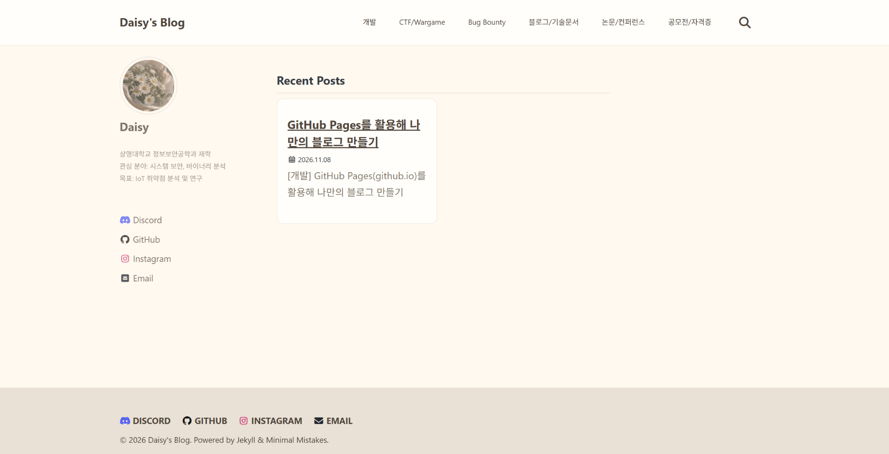

# [개발] GitHub Pages(github.io)를 활용해 나만의 블로그 만들기

## 1. 미션 목표

학습 과정과 활동 기록을 꾸준히 정리할 수 있는 개인 기술 블로그를 구축한다.

## 2. 수행 과정

### 2.1. GitHub Pages 이해 및 블로그 생성

먼저 GitHub Pages의 개념과 사용 방법을 알아보았다. GitHub Pages는 GitHub 저장소를 활용하여 정적 웹사이트를 무료로 배포할 수 있는 서비스이다.

`daisy031211.github.io` 저장소를 생성하고 GitHub Pages를 설정하여 개인 블로그를 구축하였다.

### 2.2. 템플릿 적용 및 커스터마이징

Jekyll 기반의 **Minimal Mistakes** 템플릿을 적용한 뒤 자기소개, 메뉴 구성, 디자인 등을 수정하였다.

'Daisy'라는 닉네임에 어울리도록 베이지와 아이보리 계열의 색상을 사용하여 부드럽고 따뜻한 분위기를 연출하였다. 또한 학습 분야별로 카테고리를 구성하여 게시글을 체계적으로 관리하고, 원하는 내용을 쉽게 찾아볼 수 있도록 하였다.

### 2.3. 카테고리 구성

미션 요구사항에 맞게 총 6개의 카테고리를 구성하였다.

- **개발**: 프로그래밍 및 개발 관련 학습 기록
- **CTF/Wargame**: 보안 문제 풀이 및 분석
- **Bug Bounty**: 취약점 분석 및 버그 바운티 활동
- **블로그/기술문서**: 블로그 관리 및 기술 문서 정리
- **논문/컨퍼런스**: 논문 리뷰 및 컨퍼런스 참여 기록
- **공모전/자격증**: 대회 참가 및 자격증 준비 과정

앞으로 다양한 활동을 진행하며 각 카테고리에 맞는 학습 내용과 경험을 꾸준히 기록할 예정이다.

## 3. 산출물

**GitHub Pages 블로그:** https://daisy031211.github.io/
