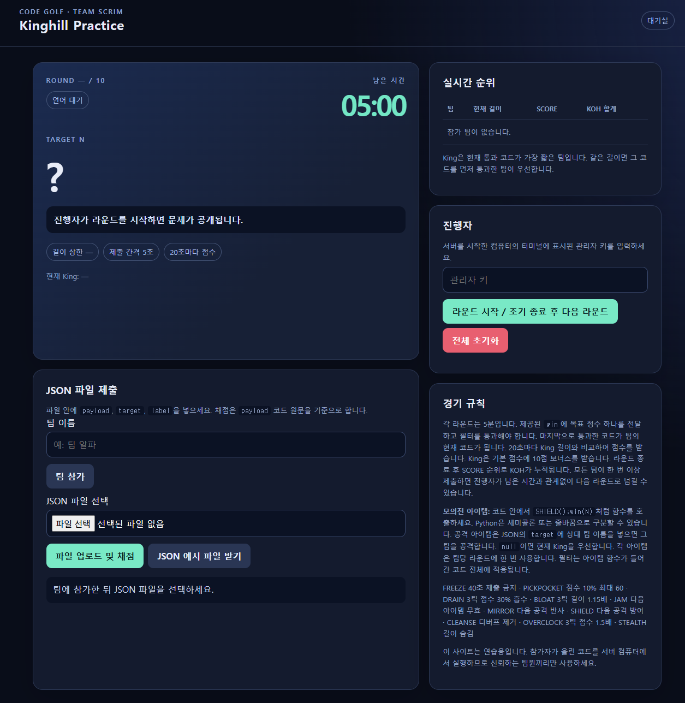

# [CTF/Wargame] 해커톤 준비 기록 - KOTH 페이로드 최적화 문제

## 1. 실습 배경

2026 충남 IT Hackathon을 준비하며 King of the Hill(KOTH) 방식의 페이로드 최적화 문제가 출제될 가능성을 고려하여 팀원들과 연습할 수 있는 모의전을 준비하였다.

실제 대회와 유사한 환경에서 연습하기 위해 AI를 활용하여 문제와 모의전 웹사이트를 제작하였다. 이후 팀원들과 직접 모의전을 진행하며 페이로드 최적화 문제의 규칙과 제출 방식을 익혔다.

## 2. 페이로드 최적화 문제의 특징

페이로드 최적화는 주어진 제약 조건을 만족하면서 목표 동작을 수행하는 코드를 작성하고, 이를 최대한 짧게 줄이는 방식의 문제이다.

이번 모의전에서는 Python과 JavaScript를 사용하였으며, 문제마다 목표 정수와 금지 문자, 코드 길이 제한 등의 조건이 주어졌다.

숫자를 직접 사용할 수 없는 경우에는 언어의 타입 변환이나 연산 결과를 이용하여 필요한 값을 만들어야 한다.

- JavaScript

```javascript
![]       // false
!![]      // true
+[]       // 0
+!+[]     // 1
```

- Python

```python
False + False  # 0
True + False   # 1
True + True    # 2
~0             # -1
-~0            # 1
```

이러한 표현을 활용하여 금지 문자를 사용하지 않으면서 목표값을 생성하는 방식을 살펴보았다.

## 3. AI를 활용한 모의전 환경 제작

팀원들과 연습하기에 적절하도록 Python과 JavaScript를 이용한 10개의 문제를 AI에게 요청하였다. 문제마다 서로 다른 제한 조건을 적용하였으며, 실제 해커톤처럼 제한 시간 안에 페이로드를 제출하고 결과를 확인할 수 있도록 웹사이트 제작도 요청하였다.

모의전에는 다음과 같은 규칙과 기능을 반영하였다.

- 각 문제의 목표값, 금지 문자, 코드 길이 제한 확인
- 라운드별 5분 제한 시간
- 제출한 코드의 실행 결과와 제한 조건 검사
- 통과한 코드 중 가장 짧은 코드를 King으로 선정
- 20초 간격으로 점수 계산
- JSON 파일 업로드를 통한 페이로드 제출

이후 아이템 기능과 모든 팀이 제출을 완료하면 다음 라운드로 넘어가는 기능도 추가하도록 요청하였다.



## 4. JSON 파일을 이용한 제출 방식

모의전에서는 페이로드를 JSON 파일로 작성한 뒤 웹사이트에 업로드하는 방식으로 제출하였다.

JSON 파일은 다음과 같은 구조로 작성하였다.

```json
{
  "payload": "win(9+1)",
  "target": null,
  "label": "my-payload"
}
```

- **payload** : 실제 실행할 코드
- **target** : 공격 대상 팀을 지정하는 값. null이면 현재 King을 우선 대상으로 설정
- **label** : 제출한 페이로드를 구분하기 위한 이름

제출할 때는 JSON 파일의 형식뿐 아니라 페이로드에 포함된 문자와 코드 길이도 확인해야 한다. 목표값이 올바르더라도 문제에서 금지한 문자가 포함되어 있거나 길이 제한을 초과하면 통과할 수 없기 때문이다.

## 5. 실습 정리

이번 실습에서는 AI를 활용하여 페이로드 최적화 KOTH 모의전 환경을 제작하고, 팀원들과 직접 실행하며 연습하였다.

Python과 JavaScript에서 숫자나 문자열을 직접 사용하지 않고 타입 변환과 연산을 통해 표현하는 방식을 살펴보았으며, 제한 조건을 만족하는 페이로드를 JSON 파일로 작성하여 제출하는 과정도 경험하였다.

실제 해커톤에서도 페이로드 최적화 유형의 문제가 출제되었다. 팀원들과 미리 모의전을 진행한 덕분에 문제의 규칙과 제출 방식에 익숙해질 수 있었고, 실제 대회에서도 문제를 이해하고 접근하는 데 도움이 되었다.
