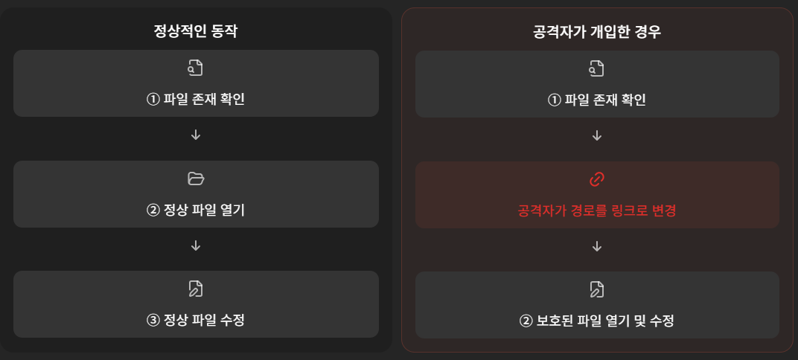
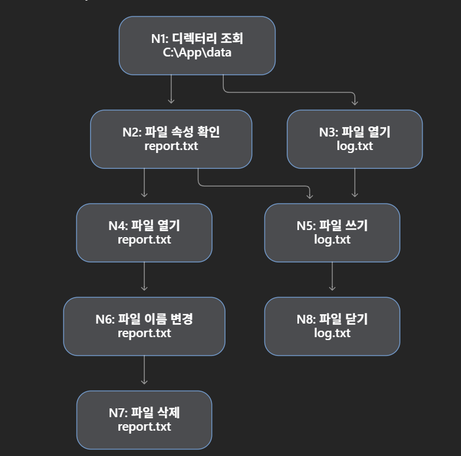
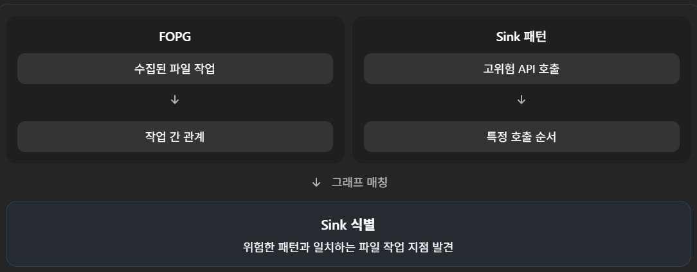
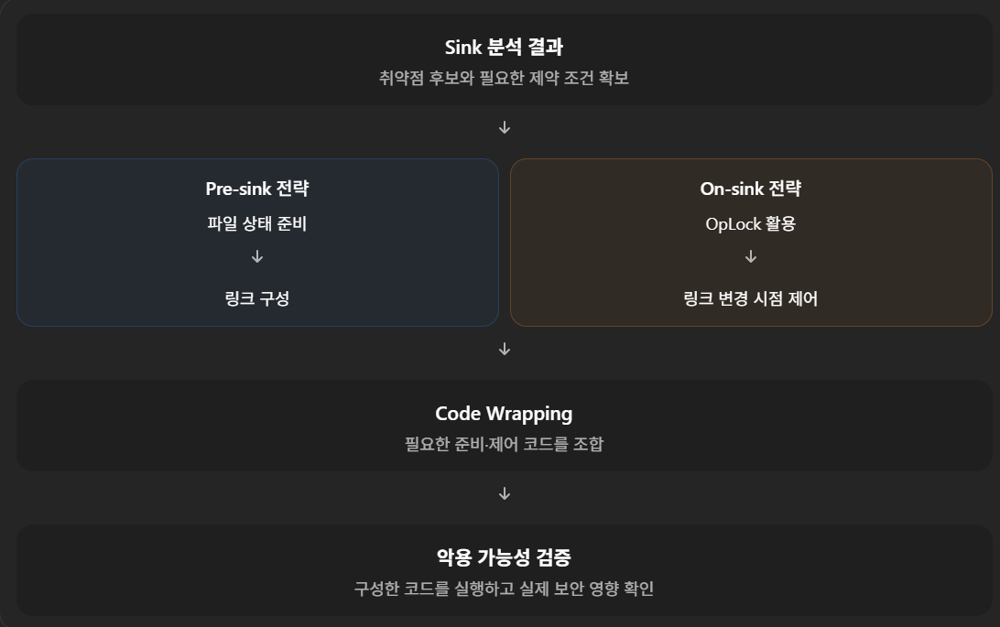

# [논문/컨퍼런스] 관심분야 논문 리뷰하기

## 리뷰 대상 논문

**논문명** : Pig in a Poke: Automatically Detecting and Exploiting Link Following Vulnerabilities in Windows File Operations

**저자** : Bocheng Xiang 외

**학회** : USENIX Security Symposium 2025

**논문 링크** : https://www.usenix.org/conference/usenixsecurity25/presentation/xiang-bocheng

취약점 분석에 관심이 있어 관련 논문을 찾아보던 중 LinkZard를 알게 되었다. 취약점이 발생하는 과정과 기존 접근 방식의 문제점을 살펴보고 이를 도구를 통해 해결하고자 한다는 점이 흥미로워 해당 논문을 선정하였다.

## 1. 연구 배경과 문제 의식

본 논문은 Windows 환경에서 발생하는 링크 추종 취약점(LFVuln)의 자동 탐지와 악용 문제를 다룬다.

**심볼릭 링크**(Symbolic Link)는 다른 파일이나 디렉터리를 가리키는 기능으로, Windows 시스템에서 널리 사용되는 메커니즘이다. 그러나 높은 권한을 가진 프로그램이 심볼릭 링크를 제대로 검증하지 않을 경우, 낮은 권한을 가진 공격자가 조작한 링크를 높은 권한의 프로그램이 따라가면서 보호된 파일에 의도치 않은 접근이나 변경을 수행할 수 있다. 이는 **링크 추종 취약점**(LFVulns)으로 이어진다. 논문에서는 이러한 취약점이 서비스 거부(Dos)나 로컬 권한 상승(LPE)으로 이어질 수 있어 보안상 중요한 문제로 여겨 이를 해결하고자 한다.

기존 연구 중 가장 밀접하게 관련된 **Jerry**는 파일 접근 권한이 취약한 경우 발생하는 파일 하이재킹 취약점을 탐지하는 도구이다. 하지만 LFVuln을 탐지하는 데에는 다음과 같은 한계가 있다.

1. **파일의 존재 여부에만 집중**하기 때문에 파일 이름이나 크기와 같은 잠재적 파일 상태를 간과하여 미탐이 발생할 수 있다.
2. **단일 파일 작업을 기준**으로 취약점을 판단하기 때문에 공격자가 제어하는 파일을 읽는 것만으로 보안 취약점으로 보고하는 오탐이 발생할 수 있다.
3. **LFVuln 악용 가능성**을 자동으로 검증하는 기능을 지원하지 않는다. 의심스러운 파일 작업이 발견될 경우 실제 보안 영향이 발생하는지 확인하려면 전문가의 별도 분석이 필요하다.

이러한 한계점들을 해결하기 위해 저자들은 LFVuln의 탐지와 악용을 자동화하는 **LinkZard**를 제안했다.

## 2. LinkZard의 핵심 아이디어와 동작 방식

LinkZard는 탐색 단계와 악용 단계 두 단계로 구성되어 있다. 탐색 단계에서 프로그램의 다양한 파일 작업을 발견하고 악용 단계에서 해당 작업이 실제 취약점으로 이어질 수 있는지 검증한다.

### 탐색 단계(Exploration Phase)

프로그램은 파일을 처리할 때 무조건 같은 동작을 수행하지 않는다. 파일이 존재하는지, 이름이나 크기가 무엇인지에 따라 실행되는 기능이 달라질 수 있다. 이처럼 특정 파일 작업에 도달하기 위해 만족해야 하는 조건을 **File State Constraint**(파일 상태 제약 조건)라고 한다.

예를 들어, 파일 크기가 1MB 이상일 때만 백업하는 프로그램이라면 500KB 파일로는 백업 기능이 실행되지 않는다. 이 경우 백업 기능에 취약점이 있더라도 해당 작업을 발견하지 못할 수도 있다.

LinkZard는 이러한 조건 때문에 놓칠 수 있는 파일 작업을 발견하기 위해 **File State Fuzzing**을 사용한다. 퍼징(Fuzzing)은 입력값을 다양하게 변경하며 프로그램의 동작을 관찰하는 테스트 기법으로 **File State Fuzzing**은 파일의 이름, 크기 등 상태를 변경하면서 프로그램이 어떤 파일 작업을 수행하는지 확인한다.

### 악용 단계(Exploitation Phase)

탐색 단계에서 발견한 다양한 파일 작업을 바탕으로 **파일 작업의 실행 순서**와 **공격자의 개입 가능성**을 분석한다.

관리자 권한 프로그램이 파일을 확인한 뒤 열어서 수정하는 과정에서 공격자가 파일 확인과 열기 사이에 경로를 심볼릭 링크로 변경할 수 있다면 프로그램이 의도하지 않은 시스템 파일을 수정할 가능성이 있다.

이처럼 링크 추종 취약점은 개별 파일 작업뿐 아니라 **작업이 실행되는 순서**에 따라서도 발생할 수 있다.

이를 분석하기 위해 LinkZard는 탐색 단계에서 수집한 파일 작업을 **FOPG**(File Operation Primitive Graph)라는 방향 그래프로 구조화한다. FOPG는 프로그램에서 발생한 파일 작업을 노드(Node)로, 작업 간의 실행 순서와 관계를 간선(Edge)으로 표현하여 프로그램의 파일 처리 흐름을 파악하는 데 사용된다.

아래 그림은 FOPG의 구조를 이해하기 위해 재구성한 예시로 각 노드는 디렉터리 조회, 파일 열기, 파일 수정 등 개별 파일 작업을 나타내며 화살표는 작업 간의 관계를 나타낸다.

이후 미리 정의한 위험한 파일 API 호출 순서 패턴을 FOPG와 비교하여 **Sink**를 식별한다. 여기서 API는 프로그램이 운영체제에 파일 열기, 읽기, 쓰기 등의 작업을 요청할 때 사용하는 기능이다. 

**Sink**는 링크 추종 취약점으로 이어질 수 있는 **위험한 파일 작업 지점**을 의미한다. 모든 파일 작업이 취약점으로 이어지는 것은 아니므로 Sink 분석을 통해 실제로 검증할 가치가 있는 취약점 후보를 선별한다.

FOPG가 파일 작업의 흐름을 정리하는 과정이라면 SInk 분석은 그 중 위험한 작업을 찾아내는 과정이다.

Sink를 발견한 후에는 실제 악용에 필요한 파일 상태 제약 조건을 분석한다. 이때 조건이 적용되는 시점에 따라 **악용 방법이 달라지기 때문에** Pre-sink와 On-sink로 구분한다.

- **Pre-sink** : 위험한 파일 작업에 **도달하기 전에 만족해야 하는 조건**이다. 공격자는 해당 조건을 먼저 충족하도록 파일 상태를 준비한 뒤 링크를 구성하는 방식을 사용할 수 있다.
- **On-sink** : 위험한 파일 작업이 **진행되는 과정에서 만족해야 하는 조건**이다. 이 경우에는 프로그램이 파일을 처리하는 도중 적절한 시점에 파일 상태나 링크를 변경해야 할 수 있다.

On-sink 유형에서는 작업 도중 개입할 시간을 확보하기 위해 Windows의 **OpLock**(Opportunistic Lock) 기능을 활용할 수 있다. OpLoak은 원래 파일 접근과 캐싱을 조정하는 기능으로 특정 상황에서 파일 작업을 지연시키는 데 활용할 수 있다.

마지막으로 LinkZard는 분석한 제약 조건에 따라 **Code Wrapping**(코드 래핑) 전략을 적용한다. 코드 래핑은 발견한 취약점 후보를 실제로 악용할 수 있는지 확인하기 위해 **파일 준비, 링크 구성, 실행 시점 제어 등에 필요한 코드를 조합**하는 방식이다.

Pre-sink 유형에서는 필요한 파일 상태를 미리 준비하고 링크를 구성하는 방식으로 접근한다. On-sink 유형에서는 OpLock을 활용해 파일 작업의 타이밍을 조절하고 적절한 시점에 링크를 변경하는 과정을 구성한다.

결과적으로 LinkZard는 **파일 작업 탐색, 위험한 작업 식별, 악용 조건 분석, 실제 악용 검증**의 과정을 자동화하여 링크 추종 취약점을 탐지하고 검증한다.

## 3. 실험 결과 및 한계점

LinkZard의 성능을 검증하기 위해 연구진은 먼저 기존에 알려진 LFVuln 42개를 재현한 데이터셋을 구성하고, 기존 탐지 도구인 Jerry를 확장한 Jerry-Ext와 비교 실험을 진행하였다. 

| 평가 지표 | Jerry-Ext | LinkZard |
| --- | --- | --- |
| TP (정탐) | 24 | 38 |
| FP (오탐) | 10 | 0 |
| FN (미탐) | 18 | 4 |
| Precision | 70.59% | 100% |
| Recall | 57.14% | 90.48% |

LinkZard는 알려진 취약점 데이터셋에서 Jerry-Ext보다 더 많은 취약점을 탐지하였으며, 오탐도 발생하지 않았다. 특히 Recall이 57.14%에서 90.48%로 증가한 것은 기존 방식에서 놓친 취약점을 추가로 탐지할 수 있었음을 보여준다.

| 버전 | 변경 사항 | Recall | Precision |
| --- | --- | --- | --- |
| LinkZard_NF | File State Fuzzing 제거 | 45.24% | 100% |
| LinkZard_NS | 단일 파일 작업을 Sink로 사용 | 90.48% | 79.17% |
| LinkZard | 전체 기능 사용 | 90.48% | 100% |

File State Fuzzing을 제거하였을 때 Recall이 45.24%로 감소한 것은 파일 상태 제약 조건을 해결하는 과정이 미탐을 줄이는 데 중요하다는 것을 보여준다. 또한, 단일 파일 작업을 Sink로 사용했을 때 Precision이 79.17%로 감소한 것은 위험한 파일 API 호출 순서를 기준으로 취약점을 판단하는 방식이 오탐을 줄이는 데 효과적임을 확인할 수 있다.

이후 연구진은 120개의 실제 프로그램에 LinkZard를 적용하여 취약점을 탐색하였다. 그 결과 49개 프로그램에서 총 55개의 제로데이 취약점을 발견하고 실제 악용에 성공하였으며, 그중 49개는 공급업체에 의해 취약점이 확인 및 패치되었다. 또한 15개의 CVE 식별자가 부여되었으며 25개는 버그 바운티 보상을 받았다.

LinkZard는 이러한 성과를 보여주었지만, 몇 가지 한계도 존재한다.

1. **파일 상태에 집중한 탐색 범위** : 레지스트리 값이나 환경 변수 등 파일 외부의 조건에 의존하는 취약점은 탐지하지 못할 수 있다. 연구진은 범위 확장에 필요한 비용을 고려하여 파일 상태에 집중하는 방식을 선택하였다.
2. **취약점 탐지와 실제 악용 사이의 차이** : 알려진 취약점 42개 중 38개를 탐지하였지만 실제 악용에는 33개만 성공하였다. 이는 취약점을 탐지하더라도 추가적인 사전 조건으로 인해 악용에 실패할 수 있음을 보여준다.
3. **Windows 환경에 특화된 구현** : LinkZard의 핵심 아이디어는 다른 운영체제에도 적용할 수 있지만, 현재 구현은 Windows 환경에 특화되어 있어 Linux나 macOS로 확장하려면 운영체제별 구현과 검증이 필요하다.

## 4. 배운 점과 향후 확장 방향

이번 논문에서 가장 인상 깊었던 부분은 논문의 전체적인 연구 흐름이었다. LFVuln의 위험성을 설명하는 것에서 시작하여 기존 연구의 한계를 분석하고 해결하기 위한 방법을 설계한 뒤 실험을 통해 각 기능의 효과를 검증하는 과정이 논리적으로 연결되어 있었다. 특히 File State Fuzzing을 제거했을 때 미탐이 증가하고 Sink 분석 방식을 변경했을 때 오탐이 증가하는 결과를 통해 각 기능의 필요성을 확인할 수 있었다.

Windows의 파일 처리 과정과 심볼릭 링크, OpLock 등의 동작 원리를 다룬 연구를 더 읽으며 LinkZard의 구현 방식을 깊이 이해해 보고 싶다. 또한 파일 상태를 확인한 시점과 실제 사용하는 시점 사이에 상태가 변경되어 발생하는 **TOCTOU**(Time-of-Check to Time-of-Use) 취약점에도 LinkZard의 파일 상태 탐색과 작업 순서 분석 방식을 활용할 수 있을지 궁금하다.

프로젝트로 발전시키게 된다면 Windows와 Linux의 파일 작업 API 및 링크 처리 방식의 차이점을 비교하고 Linux 환경에서 File State Fuzzing 기능과 Sink 패턴 탐지 기능을 구현해 보고 싶다. 더 나아가 실제 악용 가능성을 검증하는 기능까지 확장하여 LinkZard의 핵심 아이디어가 Linux에서도 유효하게 적용될 수 있는지 확인해 보고 싶다.
